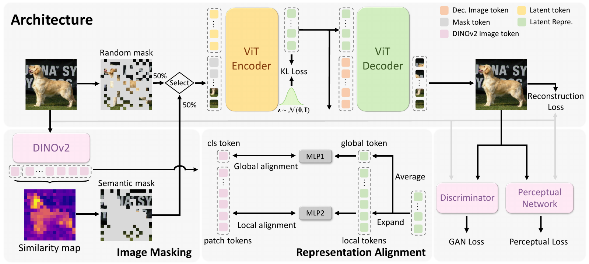
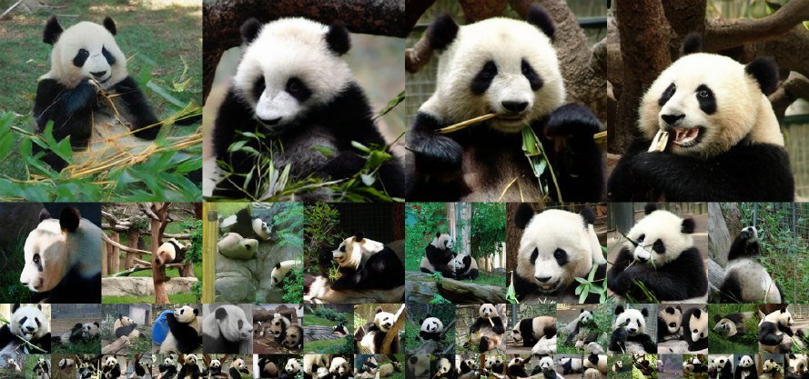
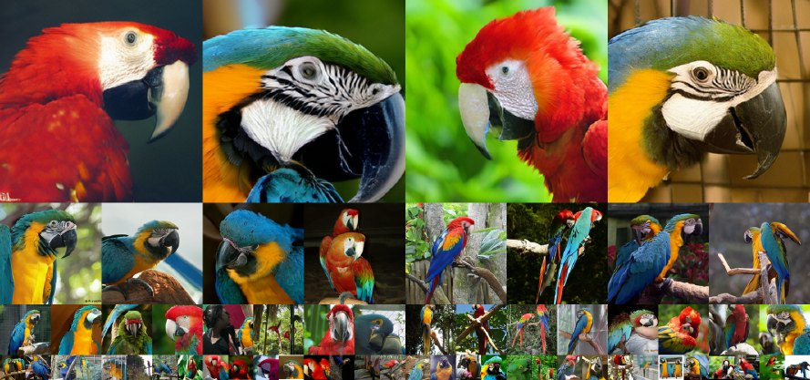
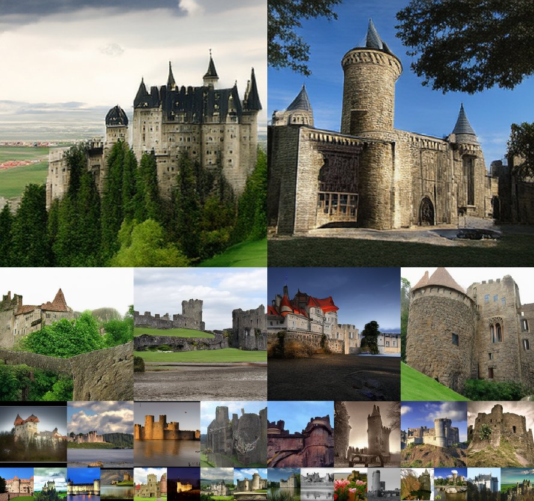
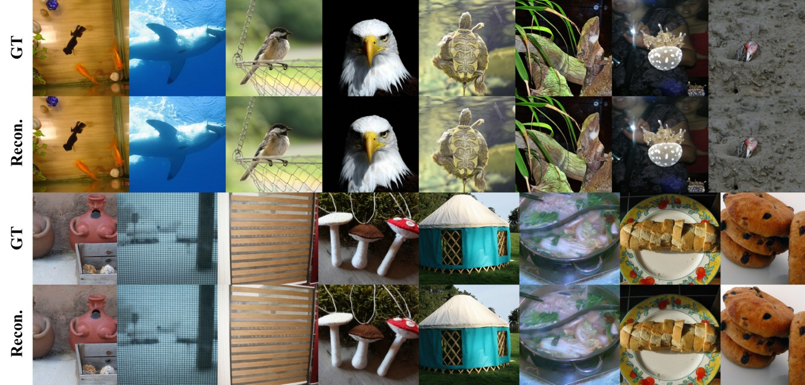

<div align="center">

<h2>MacTok: Robust Continuous Tokenization for Image Generation</h2>

CVPR 2026 · **Highlight**

Hengyu Zeng\* · Xin Gao\* · Guanghao Li · Yuxiang Yan · Jiaoyang Ruan · Junpeng Ma · Haoyu Albert Wang · Jian Pu†<br>
<sub>Fudan University &nbsp;&nbsp;|&nbsp;&nbsp; \*Equal contribution &nbsp;&nbsp;|&nbsp;&nbsp; †Corresponding author</sub>

[](https://cvpr.thecvf.com/virtual/2026/poster/36668)
[](https://www.python.org/)
[](https://pytorch.org/)

<br>
<sub>ImageNet samples at 256×256 and 512×512 from generators trained on MacTok latents (64 and 128 tokens).</sub>

</div>

---

Official PyTorch implementation of **MacTok**, a **M**asked **A**ugmenting 1D **C**ontinuous **Tok**enizer.

Continuous tokenizers compress an image into a small set of latent vectors that a diffusion model can then
generate. A KL term keeps that latent space smooth, but under strong compression it also causes **posterior
collapse**: the encoder stops writing useful information into the latents, and the decoder reconstructs from
its prior instead.

MacTok prevents collapse by making the latents indispensable. During training the encoder sees only part of
the image, so the latent tokens must carry whatever the decoder cannot infer on its own. Aligning those
tokens with pretrained DINOv2 features keeps the compressed space semantically organized. With 64 or 128
tokens, MacTok reaches a gFID of 1.44 on ImageNet 256×256 and 1.52 on 512×512.

## Highlights

- **64 or 128 tokens per image**, up to 64× fewer than conventional 2D tokenizers, at 256×256 and 512×512.
- **State-of-the-art generation quality**: gFID 1.44 (256×256) and 1.52 (512×512) with SiT-XL.
- **No posterior collapse**, because masked reconstruction forces real information into the latents.
- **Semantically structured latents** from joint global and local DINOv2 alignment, which makes the
  downstream diffusion model easier to train.

## Method

<div align="center">
  
</div>

A ViT encoder takes an image split into patch tokens, concatenates a learnable set of `L` latent tokens,
and keeps the encoder outputs at the latent positions as the continuous code. That code is treated as a
Gaussian and regularized toward an isotropic prior. A ViT decoder reconstructs the image from it. Three
ingredients keep the code informative under this constraint.

**Masked reconstruction.** A fraction of patches is replaced by mask tokens before encoding, so the model
must reconstruct the full image from partial evidence. The mask ratio is drawn from `max(0, U(-0.1, M))`
with `M = 0.7`; the negative lower bound means the model occasionally sees an unmasked image, which stops
persistent masking from degrading reconstruction quality.

**Semantic masking.** Random masking ignores image content, so MacTok adds a second strategy that scores
each patch by its cosine similarity to the DINOv2 class token and masks the highest-scoring ones. Hiding
the most informative regions makes the task harder and pushes object-level structure into the latents. The
two strategies are applied with equal probability during training.

**Representation alignment.** Each latent token is repeated to patch granularity and aligned with DINOv2
features both locally and globally. Local alignment preserves fine detail, global alignment preserves
overall structure, and together they keep the compressed space discriminative.

## Results

System-level comparison on ImageNet class-conditional generation. Every generator is a 675M-parameter
model. Best values per column are in bold.

<div align="center">

<table>
<thead>
<tr>
  <th rowspan="2" align="left">Tokenizer&nbsp;+&nbsp;Generator</th>
  <th rowspan="2">Latent&nbsp;type</th>
  <th rowspan="2">Tok.&nbsp;params</th>
  <th rowspan="2">Tokens&nbsp;↓</th>
  <th rowspan="2">rFID&nbsp;↓</th>
  <th colspan="2">without&nbsp;CFG</th>
  <th colspan="2">with&nbsp;CFG</th>
</tr>
<tr><th>gFID&nbsp;↓</th><th>IS&nbsp;↑</th><th>gFID&nbsp;↓</th><th>IS&nbsp;↑</th></tr>
</thead>
<tbody>
<tr><td colspan="9" align="center"><b>ImageNet 256×256</b></td></tr>
<tr><td align="left">MAETok + SiT-XL</td>      <td>AE, 1D</td>    <td>176M</td><td>128</td><td>0.48</td><td>2.31</td><td>216.5</td><td>1.67</td><td>311.2</td></tr>
<tr><td align="left">SoftVQ-VAE + SiT-XL</td>  <td>SoftVQ, 1D</td><td>176M</td><td>64</td> <td>0.88</td><td>5.98</td><td>138.0</td><td>1.78</td><td>279.0</td></tr>
<tr><td align="left">MacTok + LightningDiT</td><td>KL, 1D</td>    <td>176M</td><td>64</td> <td>0.75</td><td>4.15</td><td>167.8</td><td>1.68</td><td>307.3</td></tr>
<tr><td align="left">MacTok + LightningDiT</td><td>KL, 1D</td>    <td>176M</td><td>128</td><td>0.43</td><td>3.12</td><td>186.2</td><td>1.50</td><td>299.8</td></tr>
<tr><td align="left">MacTok + SiT-XL</td>      <td>KL, 1D</td>    <td>176M</td><td>64</td> <td>0.75</td><td>3.77</td><td>181.6</td><td>1.58</td><td>310.4</td></tr>
<tr><td align="left"><b>MacTok + SiT-XL</b></td><td><b>KL, 1D</b></td><td><b>176M</b></td><td><b>128</b></td><td><b>0.43</b></td><td><b>2.82</b></td><td><b>189.2</b></td><td><b>1.44</b></td><td>302.5</td></tr>
<tr><td colspan="9" align="center"><b>ImageNet 512×512</b></td></tr>
<tr><td align="left">TexTok-128 + SiT-XL</td>  <td>KL, 1D</td>    <td>176M</td><td>128</td><td>0.97</td><td>–</td>   <td>–</td>    <td>1.80</td><td>305.4</td></tr>
<tr><td align="left">MAETok + SiT-XL</td>      <td>AE, 1D</td>    <td>176M</td><td>128</td><td>0.62</td><td>2.79</td><td>204.3</td><td>1.69</td><td>304.2</td></tr>
<tr><td align="left">SoftVQ-VAE + SiT-XL</td>  <td>SoftVQ, 1D</td><td>391M</td><td>64</td> <td>0.71</td><td>7.96</td><td>133.9</td><td>2.21</td><td>290.5</td></tr>
<tr><td align="left">MacTok + SiT-XL</td>      <td>KL, 1D</td>    <td>391M</td><td>64</td> <td>0.89</td><td>4.63</td><td>163.7</td><td><b>1.52</b></td><td>306.0</td></tr>
<tr><td align="left"><b>MacTok + SiT-XL</b></td><td><b>KL, 1D</b></td><td><b>176M</b></td><td><b>128</b></td><td>0.79</td><td>5.12</td><td>156.3</td><td><b>1.52</b></td><td><b>316.0</b></td></tr>
</tbody>
</table>

</div>

### Uncurated samples

<div align="center">
  <br>
  <br>
  <sub>Uncurated ImageNet 256×256 samples from SiT-XL with MacTok (128 tokens), CFG 4.0.
  Classes: <i>panda</i> (388) and <i>macaw</i> (88).</sub>
</div>

<div align="center">
  
  <br>
  <sub>Uncurated ImageNet 512×512 samples from SiT-XL with MacTok.
  Classes: <i>castle</i> (483, 128 tokens) and <i>volcano</i> (980, 64 tokens).</sub>
</div>

### Reconstruction

<div align="center">
  <br>
  <sub>Reconstructions from the 128-token MacTok tokenizer.</sub>
</div>

## Installation

```bash
git clone https://github.com/alienflm/MacTok.git
cd MacTok

conda create -n mactok python=3.10 -y
conda activate mactok

pip install -r requirements.txt
```

The pinned stack is CUDA-based PyTorch 2.5.1 with `timm` 1.0.12 and `flash-attn` 2.7.2.post1.
`flash-attn` builds against your local CUDA toolkit and is required by the DiT, SiT, and DINO
discriminator modules, so install it after PyTorch is already present.

DINOv2 backbones (encoder, decoder, REPA target, and discriminator) are resolved through `timm`
and downloaded automatically on first use.

## Data preparation

All entry points expect an ImageNet-style directory tree:

```
ImageNet/
├── train/
│   ├── n01440764/
│   │   ├── n01440764_10026.JPEG
│   │   └── ...
│   └── n01443537/
└── val/
    └── n01440764/
```

Point the configs and scripts at your copy by editing `data_path` in the YAML files, or by passing
`--data-path` on the command line.

## Usage

### 1. Train the tokenizer

Configurations live in [`configs/tokenizer/`](configs/tokenizer). The two released settings differ only
in `num_latent_tokens`:

| Config | Latent tokens | Latent dim | Encoder / Decoder |
|---|:--:|:--:|---|
| [`mactok-b-64.yaml`](configs/tokenizer/mactok-b-64.yaml) | 64 | 32 | ViT-B/16 (DINOv2-initialized encoder) |
| [`mactok-b-128.yaml`](configs/tokenizer/mactok-b-128.yaml) | 128 | 32 | ViT-B/16 (DINOv2-initialized encoder) |

```bash
torchrun --nproc_per_node=8 train/train_tokenizer.py \
    --config configs/tokenizer/mactok-b-128.yaml
```

Before launching, review these keys, which point at local resources:

| Key | Default | Meaning |
|---|---|---|
| `data_path` | `./ImageNet/train` | Training image root |
| `results_dir` | `experiments/tokenizer` | Checkpoint and log output |
| `cloud_save_path` | `experiments/tokenizer` | Mirror of the checkpoint directory |
| `global_batch_size` | `256` | Batch size summed across all ranks |
| `epochs` | `50` | Training length |

The masking and alignment behaviour described above is controlled by `enc_token_drop: 0.7`
(the mask-ratio upper bound *M*), `enc_dino_mask: True` (enables DINO-guided semantic masking), and
`repa: True` with `repa_align: repeat` and `repa_loss_weight: 0.1` (representation alignment).

Any config key may be overridden on the command line, for example `--enc-token-drop 0.5`.

### 2. Evaluate reconstruction

Reports rFID, PSNR, and SSIM for a trained tokenizer:

```bash
torchrun --nproc_per_node=8 inference/reconstruct.py \
    --config configs/tokenizer/mactok-b-128.yaml \
    --vq-ckpt experiments/tokenizer/<run>/checkpoints/<step>.pt \
    --data-path /path/to/ImageNet/val \
    --image-size 256 \
    --sample-dir reconstructions
```

### 3. Cache latents

Training the latent generator is far faster on pre-encoded latents. This writes `.safetensors` shards:

```bash
torchrun --nproc_per_node=8 inference/cache_latent_safetensors.py \
    --config configs/tokenizer/mactok-b-128.yaml \
    --vq-ckpt experiments/tokenizer/<run>/checkpoints/<step>.pt \
    --data-path /path/to/ImageNet \
    --split train \
    --sample-dir cached_latents
```

### 4. Train the latent generator

**SiT** (Accelerate-based, used for the headline numbers):

```bash
accelerate launch train/train_sit.py \
    --model SiT-XL/2 \
    --dataset imagenet_cached \
    --data-dir cached_latents \
    --vae-config configs/tokenizer/mactok-b-128.yaml \
    --vae-ckpt experiments/tokenizer/<run>/checkpoints/<step>.pt \
    --batch-size 256 \
    --max-train-steps 400000 \
    --output-dir exps
```

**DiT** (`torchrun`-based):

```bash
torchrun --nproc_per_node=8 train/train_dit.py \
    --model DiT-XL/2 \
    --dataset imagenet_cached \
    --data-path cached_latents \
    --vq-ckpt experiments/tokenizer/<run>/checkpoints/<step>.pt \
    --image-size 256 \
    --global-batch-size 256 \
    --results-dir results
```

### 5. Sample and evaluate

Generate a 50K-sample `.npz` for FID evaluation:

```bash
torchrun --nproc_per_node=8 inference/generate_sit.py \
    --model SiT-XL/2 \
    --ckpt exps/<run>/checkpoints/<step>.pt \
    --vae-config configs/tokenizer/mactok-b-128.yaml \
    --vae-ckpt experiments/tokenizer/<run>/checkpoints/<step>.pt \
    --resolution 256 \
    --num-fid-samples 50000 \
    --cfg-scale 1.5 \
    --num-steps 50 \
    --sample-dir samples
```

Then score it against the ImageNet reference batch with the ADM evaluation suite:

```bash
python inference/evaluator.py \
    --ref_batch VIRTUAL_imagenet256_labeled.npz \
    --sample_batch samples/<run>.npz
```

This reports Inception Score, FID, sFID, precision, and recall, and appends the results next to the
sample file. Pass `--ref_stats_cache stats.npz` to cache the reference statistics across runs.

> **Note:** `inference/evaluator.py` uses the original TensorFlow 1.x ADM evaluator and therefore needs a
> separate environment with `tensorflow` installed. It is deliberately not part of `requirements.txt`.

## Repository layout

```
MacTok/
├── configs/tokenizer/   # YAML configs for the 64- and 128-token tokenizers
├── modelling/           # Tokenizer, DiT/SiT, quantizers, ViT backbones, discriminators, LPIPS
│   ├── tokenizer.py     #   MacTok encoder/decoder and latent interface
│   ├── modules/         #   DINOv2-decoupled ViT with masking (decouple_vit_models.py)
│   ├── quantizers/      #   KL / VQ / SoftVQ latent parameterizations
│   ├── discriminators/  #   DINO, StyleGAN, and PatchGAN discriminators
│   └── diffusion/       #   Gaussian diffusion utilities for DiT
├── losses/              # VQLoss, adversarial losses, SILoss, DiffLoss
├── transport/           # Interpolant transport, samplers, ODE/SDE integrators for SiT
├── train/               # train_tokenizer.py, train_dit.py, train_sit.py
├── inference/           # reconstruct.py, cache_latent_safetensors.py, generate_*.py, evaluator.py
└── utils/               # Datasets, distributed helpers, EMA, logging, checkpointing
```

## Citation

If you find MacTok useful in your research, please cite:

```bibtex
@inproceedings{zeng2026mactok,
  title     = {MacTok: Robust Continuous Tokenization for Image Generation},
  author    = {Zeng, Hengyu and Gao, Xin and Li, Guanghao and Yan, Yuxiang and
               Ruan, Jiaoyang and Ma, Junpeng and Wang, Haoyu Albert and Pu, Jian},
  booktitle = {Proceedings of the IEEE/CVF Conference on Computer Vision and Pattern Recognition (CVPR)},
  year      = {2026}
}
```

## Acknowledgments

This repository builds on several excellent open-source projects:

- [continuous_tokenizer](https://github.com/Hhhhhhao/continuous_tokenizer) (SoftVQ-VAE & MAETok)
- [LightningDiT](https://github.com/hustvl/LightningDiT)
- [SiT](https://github.com/willisma/SiT)
- [DiT](https://github.com/facebookresearch/DiT)
- [DINOv2](https://github.com/facebookresearch/dinov2)
- [timm](https://github.com/huggingface/pytorch-image-models)

We thank the authors for making their work available.

## License

Released under the [MIT License](LICENSE). Code derived from the projects listed above remains subject
to their respective licenses.
